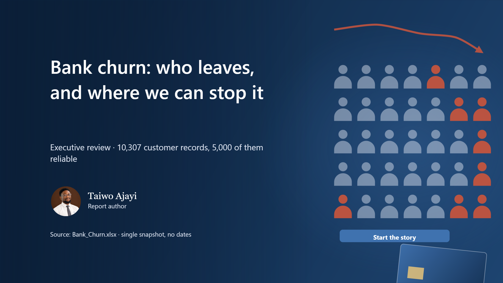
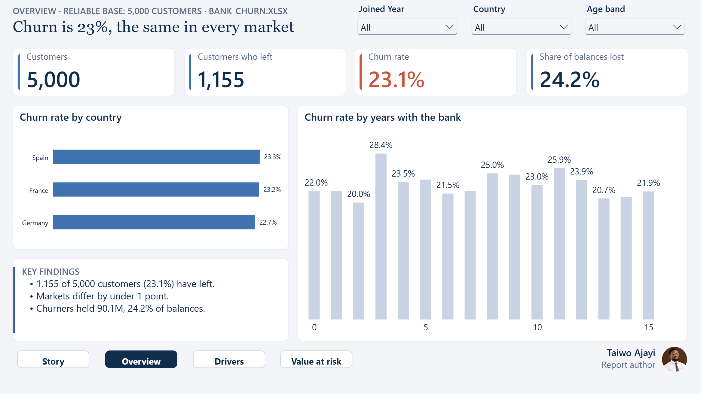
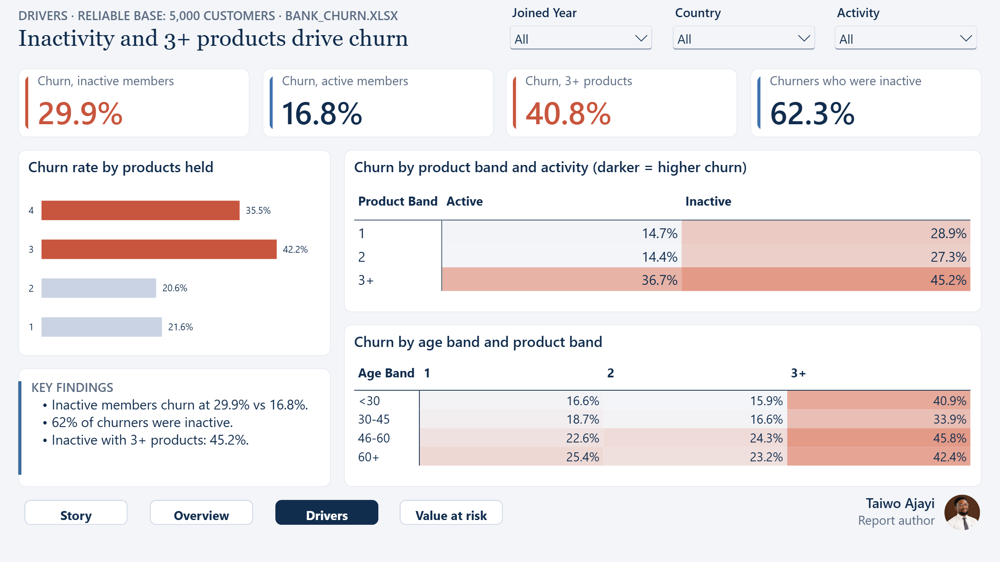
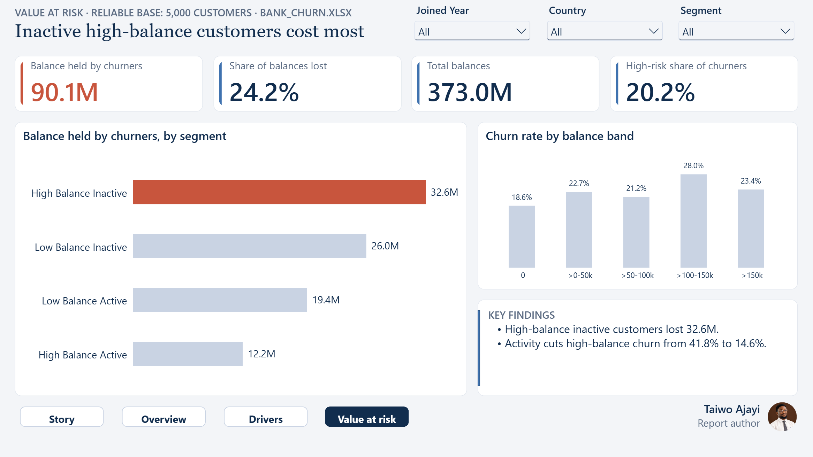

# Bank Customer Churn Analysis

**Bank churn: who leaves, and where we can stop it**

A retail bank in three markets is losing customers. I found who leaves, why, and which two actions would keep the most of them.

| | |
|---|---|
| **Domain** | Retail banking |
| **Data** | 10,307 customer records (5,000 reliable), 1 snapshot |
| **Model** | Star schema: 1 fact, 8 dimensions, 42 measures |
| **Report** | 15 pages: 11 story, 3 dashboards, 1 drill-through |
| **Author** | Taiwo Ajayi |
| **Tools** | Power BI, DAX, Power Query, Data modelling, Data quality, Storytelling |

## The challenge

The bank believed churn was random, that more products and higher balances made customers stickier, and that country and gender mattered. Management needed to know which beliefs held, who actually leaves, and where retention money would work.

## The data

One Excel workbook with a customer table and six lookup sheets. Profiling showed the file splits at row 5,000: the later 5,307 rows churn at a flat 51% in every group and contradict their own band keys in 98% of cases. I based every finding on the 5,000 reliable rows and kept the rest, flagged, for transparency.

## My approach

1. Profiled the workbook and found the reliable / suspect split at row 5,000.
2. Rebuilt band and segment keys in Power Query and flagged blank balances and impossible ages.
3. Designed a star schema with 8 dimensions and 42 explicit DAX measures in display folders.
4. Tested five management beliefs against the data and wrote each story page around one finding.
5. Built three executive dashboards with synced slicers and a customer drill-through.

## Headline numbers

| 23.1% | 90.1M | 62% | ~170 |
|---|---|---|---|
| churn rate (1,155 of 5,000) | balances held by churners | of churners were inactive | leavers two actions could keep |

## Key insights

- **Inactivity is the biggest driver.** Inactive members churn at 29.9% against 16.8% for active ones.
- **A third product adds risk.** Customers with 3+ products churn at 41%, twice the rate of those with 1-2.
- **High balance is not safe.** High-balance inactive customers churn at 41.8%; high-balance active at 14.6%.
- **Demographics do not separate leavers.** Every country and both genders churn at about 23%.
- **Half the file is unreliable.** 5,307 records churn at 51% in every group and were excluded from findings.

## Recommendations

1. Reactivate the 2,410 inactive members, starting with the 624 high-balance inactive.
2. Review bundles: stop pushing a third product.
3. Fix the source of the 5,307 suspect records.

## Dashboards

### D1 Churn overview
Churn by market, tenure and headline KPIs.

### D2 Customer drivers
Activity and product heat maps.

### D3 Value at risk
Balances lost by segment.

## What I fixed in the original analysis

- Separated reliable and suspect records instead of reporting a blended 37.6% churn rate.
- Rebuilt band and segment keys that contradicted the raw values.
- Treated 100 blank balances as zero and flagged them.

## Files

- `Bank_Churn_Case_Study.pdf`: this case study as a 6-page PDF
- `Bank_Churn_Full_Report.pdf`: every page of the 15-page report
- `Bank_Churn_Report_Guide.pdf`: detailed report guide (build, model, measures, maintenance)
- `images/`: every report page as a PNG
