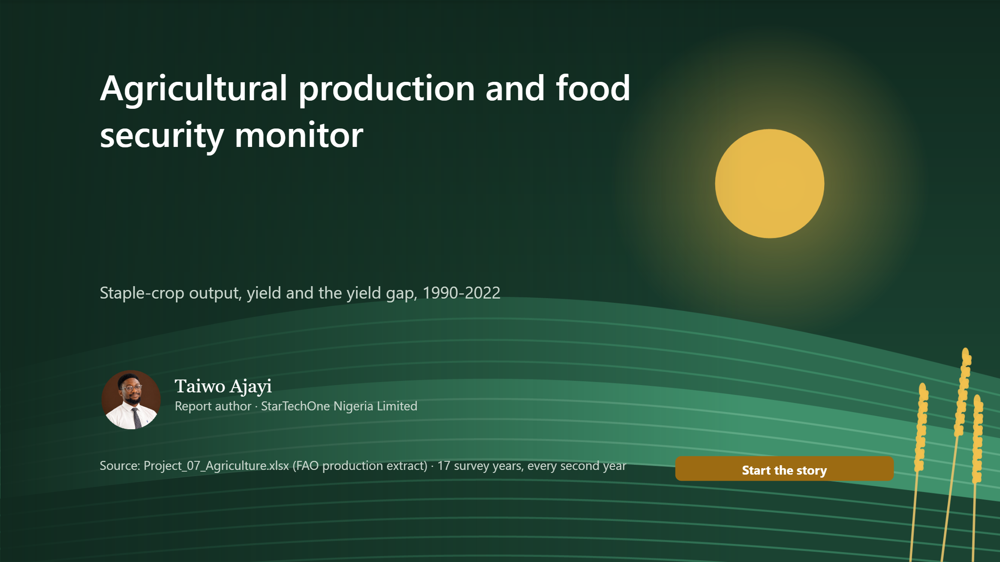
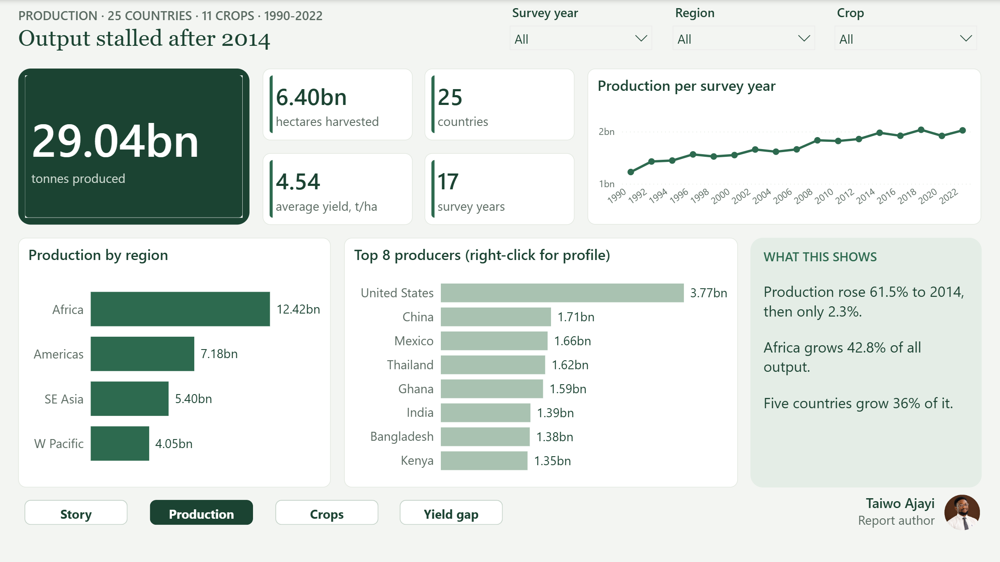
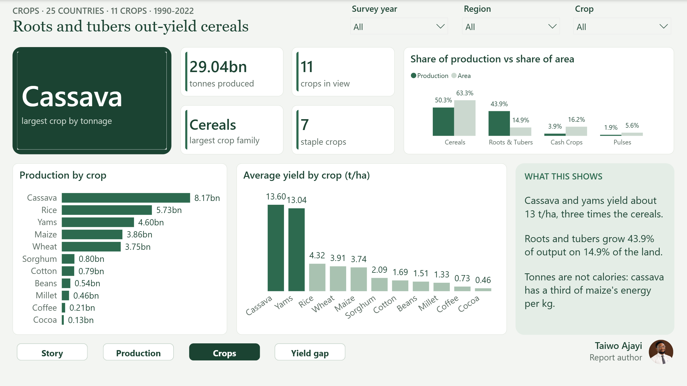
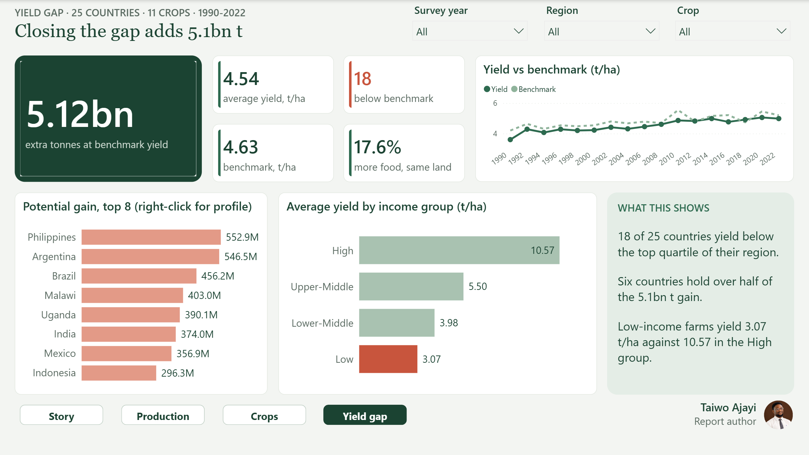

# FAO Agricultural Production & Yield Gap

**Agricultural production and food security monitor**

Staple-crop output across 25 countries grew 65% since 1990, but yield stopped improving in 2014. I measured the yield gap and where closing it would add the most food.

| | |
|---|---|
| **Domain** | Agriculture and food security |
| **Data** | 25 countries, 11 crops, 17 survey years (1990-2022) |
| **Model** | Star schema: 1 fact, 4 dimensions, measures table |
| **Report** | 17 pages: 13 story, 3 bento dashboards, 1 drill-through |
| **Author** | Taiwo Ajayi |
| **Tools** | Power BI, DAX, Data modelling, Benchmarking, Public data, Storytelling |

## The challenge

Policy and investment decision-makers needed to know whether staple-crop production is still growing, whether growth comes from yield or more land, and where raising yields to the regional best would add the most food.

## The data

An FAO-style production extract: production, area harvested and yield by country, crop and survey year (every second year). 14.6% of records are estimates and 252 values are blank. Totals add up all 17 survey years, so trend pages show one year at a time.

## My approach

1. Profiled the workbook and checked every headline number against the source.
2. Fixed the regional benchmark so it is a true 75th percentile of country yields.
3. Removed a wrong hg/ha conversion that shrank the potential-gain figure 10,000 times.
4. Added 12 measures (shares, survey-year values, gap counts, potential gain %).
5. Built 13 story pages and 3 bento dashboards with synced Year, Region and Crop filters.

## Headline numbers

| 29.0bn t | 4.54 t/ha | 18 of 25 | +5.1bn t |
|---|---|---|---|
| production, all survey years | average yield | countries below benchmark | if yield gaps closed (+17.6%) |

## Key insights

- **Growth has stalled.** Production rose 61.5% from 1990 to 2014, then only 2.3% by 2022.
- **Yield is flat since 2014.** 3.60 t/ha in 1990, 4.98 in 2014, still 4.98 in 2022.
- **Africa grows most, yields least.** 42.8% of all output at the lowest regional yield, 3.67 t/ha.
- **Roots and tubers are efficient.** 14.9% of the land, 43.9% of the tonnage.
- **Six countries hold half the upside.** Philippines, Argentina, Brazil, Malawi, Uganda and India.

## Recommendations

1. Close Africa's yield gap: seeds, fertiliser and extension.
2. Restart yield growth with research and irrigation in the six largest-gain countries.
3. Back roots and tubers with storage and processing.

## Dashboards

### D1 Production overview
Output, trend, regions and top producers.

### D2 Crop analysis
Crops, crop families and yields.

### D3 Yield and gap
Yield vs benchmark and potential gain.

## What I fixed in the original analysis

- Corrected swapped region shares on the original insights page.
- Replaced a mislabelled "top-quartile" benchmark with a true 75th percentile.
- Removed a divide-by-10,000 error in potential production gain.

## Files

- `FAO_Agriculture_Case_Study.pdf`: this case study as a 6-page PDF
- `FAO_Agriculture_Full_Report.pdf`: every page of the 17-page report
- `FAO_Report_Guide.pdf`: detailed report guide (build, model, measures, maintenance)
- `images/`: every report page as a PNG
