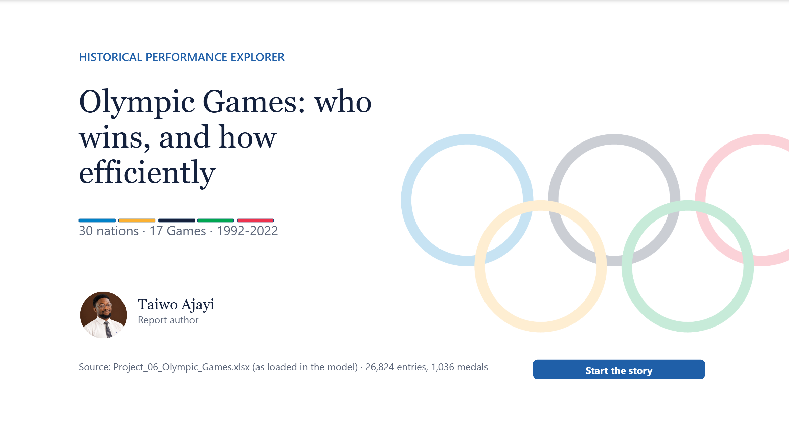
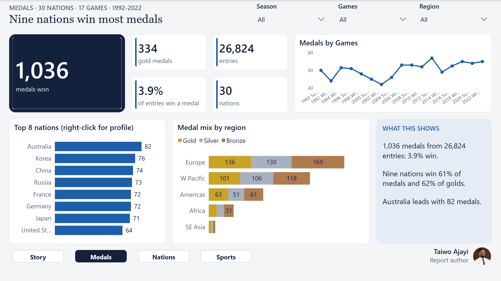
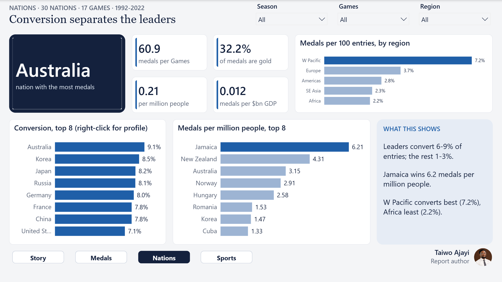
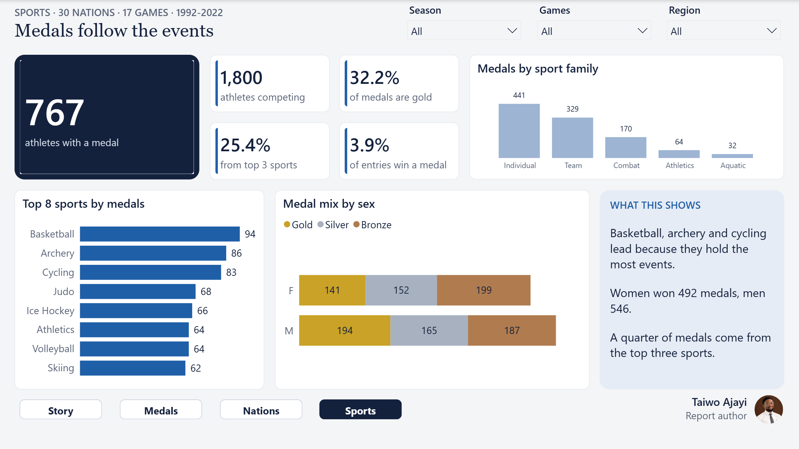

# Olympic Games Performance Explorer

**Olympic Games: who wins, and how efficiently**

Across 17 Summer and Winter Games, nine nations win 61% of all medals. I measured how efficiently each nation turns entries into medals.

| | |
|---|---|
| **Domain** | Sports analytics |
| **Data** | 30 nations, 17 Games (1992-2022), 26,824 entries |
| **Model** | Star schema around FactResult, calculated medal table |
| **Report** | 18 pages: 14 story, 3 bento dashboards, 1 drill-through |
| **Author** | Taiwo Ajayi |
| **Tools** | Power BI, DAX, Data validation, Data modelling, Sports analytics, Storytelling |

## The challenge

Olympic committees and sport funders wanted to know which nations win, how efficiently they convert entries into medals, and whether population, wealth, region or hosting explain success.

## The data

A teaching dataset of athlete entries with medal outcomes, nations, Games, events, sports and athletes. Only 13% of event-Games have medals, every sport appears in both seasons and ages run from -13 to 57, so findings compare nations within the dataset rather than real Olympic history.

## My approach

1. Audited the original report and found it counted every entry as a medal (23K instead of 1,036).
2. Fixed medal, per-capita and per-GDP measures and replaced a broken specialisation index.
3. Added conversion, medals-per-Games and host-effect measures, checked with DAX queries.
4. Dropped forecast pages the data could not support and documented the limits openly.
5. Built 14 story pages and 3 bento dashboards with a nation drill-through.

## Headline numbers

| 1,036 | 3.9% | 61% | 6.2 |
|---|---|---|---|
| medals (334 gold) | of entries win a medal | of medals won by nine nations | medals per million people (Jamaica) |

## Key insights

- **Medals are concentrated.** Nine nations win 631 of 1,036 medals and 62% of the golds.
- **Conversion separates the leaders.** They turn 6-9% of entries into medals; everyone else 1-3%.
- **Small nations punch above their weight.** Jamaica 6.2 medals per million people, New Zealand 4.3.
- **No home advantage.** Hosts won 2.75 medals at home against 3.15 in an average Games.
- **Women and men win almost equally.** 492 medals against 546 from equal athlete numbers.

## Recommendations

1. Fund conversion, not entries.
2. Benchmark smaller nations per head and per $bn GDP.
3. Reload a complete medal list before any forecast.

## Dashboards

### D1 Medal overview
Medals, conversion, trend and medal mix.

### D2 Nations and efficiency
Conversion, per-capita and per-GDP.

### D3 Sports and athletes
Sports, families and medallists.

## What I fixed in the original analysis

- Total Medals counted 21,571 "no medal" keys; corrected from 23K to 1,036.
- Per-million and per-$bn measures divided by a million and a billion twice.
- Old pages named the USA as leader; on real medals Australia leads.

## Files

- `Olympics_Case_Study.pdf`: this case study as a 6-page PDF
- `Olympics_Full_Report.pdf`: every page of the 18-page report
- `Olympics_Report_Guide.pdf`: detailed report guide (build, model, measures, maintenance)
- `images/`: every report page as a PNG

> The cover uses the Olympic rings, a trademark of the International Olympic Committee, for an educational portfolio piece only.
