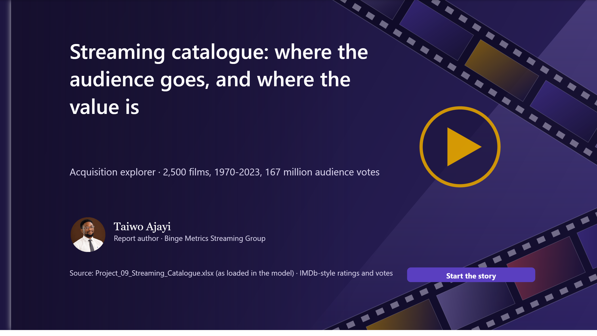
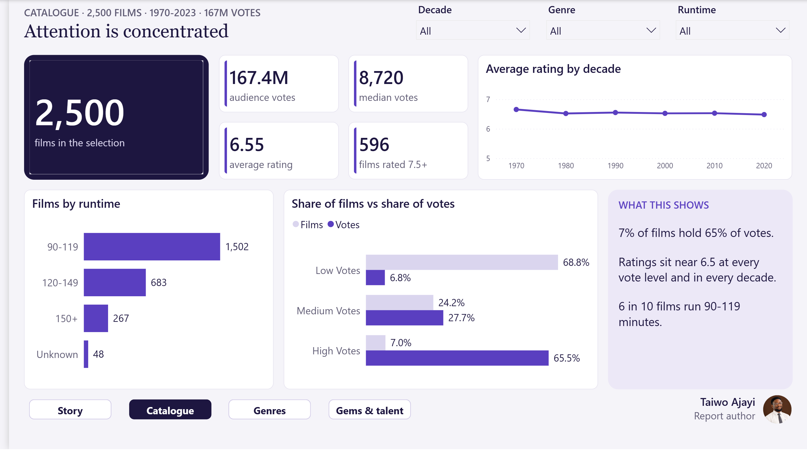
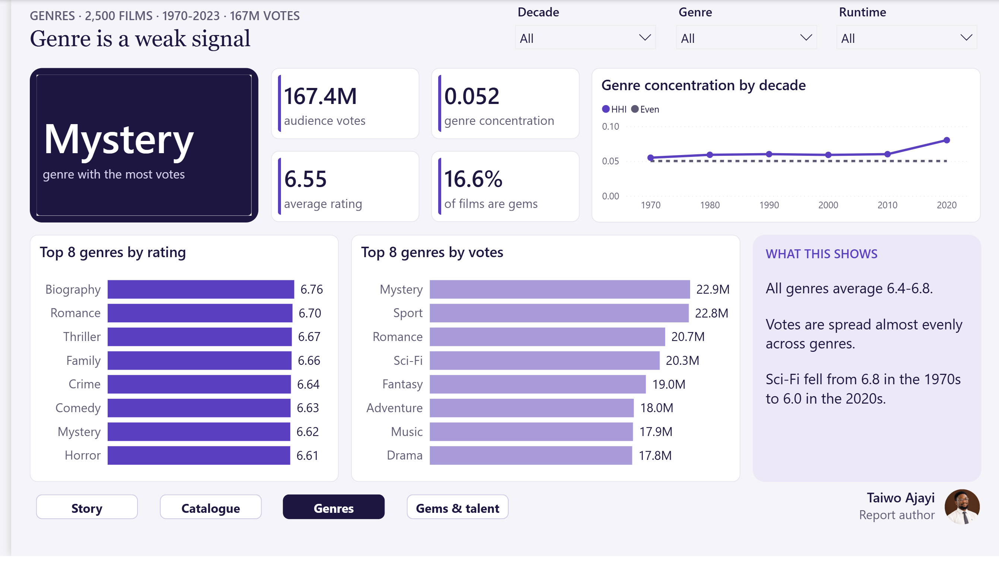
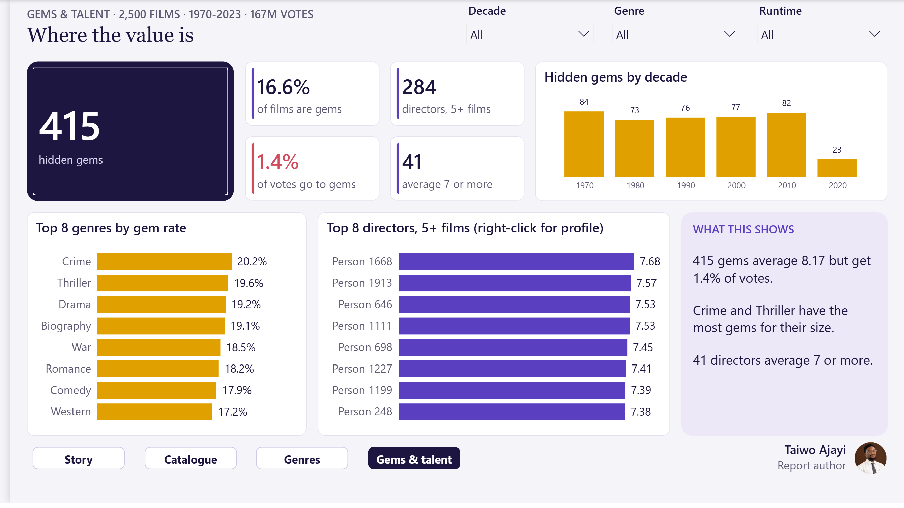

# Streaming Catalogue Acquisition Explorer

**Streaming catalogue: where the audience goes, and where the value is**

7% of 2,500 films hold 65% of all audience votes, and popularity says nothing about quality. I found 415 well-rated, little-seen films worth licensing.

| | |
|---|---|
| **Domain** | Media and streaming |
| **Data** | 2,500 films (1970-2023), 167M votes, 2,000 people |
| **Model** | Film-centred model with genre and talent bridges |
| **Report** | 17 pages: 13 story, 3 bento dashboards, 1 drill-through |
| **Author** | Taiwo Ajayi |
| **Tools** | Power BI, DAX, Many-to-many modelling, Content analytics, Data validation, Storytelling |

## The challenge

An acquisitions team wanted to know where audience attention goes, whether popularity or genre predicts a good rating, and which films and directors are worth licensing.

## The data

An IMDb-style catalogue: one rating per film, with bridge tables linking films to about two genres each and to directors and cast. Titles and people are anonymised, and runtimes take only a few values, so it is a teaching sample rather than a live catalogue.

## My approach

1. Checked every measure with DAX queries against the stored data.
2. Fixed a genre concentration index that squared shares adding up to 200%.
3. Relabelled 48 films with no runtime that were reported as "Under 60".
4. Added hidden-gem, vote-concentration and director track-record measures.
5. Built 13 story pages and 3 bento dashboards with a director drill-through.

## Headline numbers

| 2,500 | 65% | 6.55 | 415 |
|---|---|---|---|
| films, 1970-2023 | of votes held by 7% of films | average rating at every vote level | hidden gems to license |

## Key insights

- **Attention is concentrated.** 175 high-vote films hold 65% of votes; the bottom half hold 2.6%.
- **Popularity does not predict quality.** Low-vote films average 6.53, high-vote films 6.59.
- **415 hidden gems.** Rated 7.5+ with under 25,000 votes; they average 8.17 but get 1.4% of votes.
- **Genre is a weak signal.** All 20 genres average between 6.4 and 6.8.
- **Directors are a strong signal.** Director averages range from 5.1 to 7.7; 41 average 7 or more.

## Recommendations

1. License the hidden gems, starting with Crime, Thriller, Drama and Biography.
2. Shortlist by director track record.
3. Do not pay a premium for vote counts alone.

## Dashboards

### D1 Catalogue overview
Films, votes, ratings and runtime.

### D2 Genres and audience
Genre ratings, votes and concentration.

### D3 Hidden gems and talent
Gems by genre and top directors.

## What I fixed in the original analysis

- "Rising genre concentration" was a calculation error; votes are spread almost evenly.
- The "Under 60" runtime group was missing data; relabelled "Unknown".
- Hidden-gem counts showed decimals (415.00).

## Files

- `Streaming_Catalogue_Case_Study.pdf`: this case study as a 6-page PDF
- `Streaming_Catalogue_Full_Report.pdf`: every page of the 17-page report
- `Streaming_Catalogue_Report_Guide.pdf`: detailed report guide (build, model, measures, maintenance)
- `images/`: every report page as a PNG
