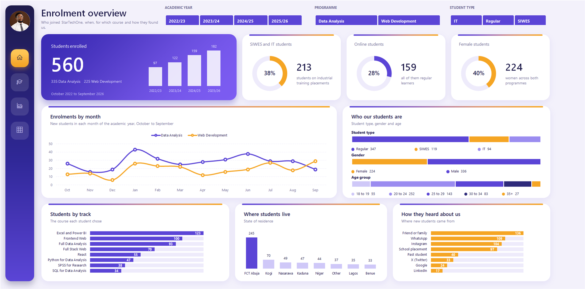
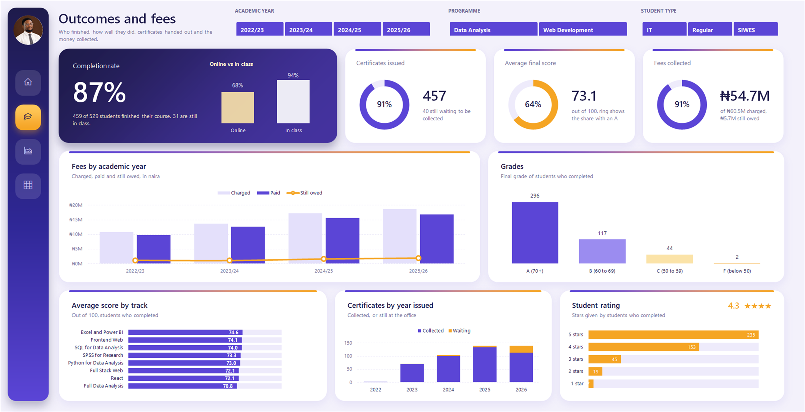

# StarTechOne Student Enrolments (Excel)

**StarTechOne student enrolments dashboard**

A two-page interactive Excel dashboard for a tech training academy: who joins, who finishes, and how much of the fees are collected, filtered with three clicks and no formulas.

| | |
|---|---|
| **Domain** | Education and training |
| **Data** | 560 students, Oct 2022 to Sep 2026, 30 columns |
| **Model** | Excel Table, 14 PivotTables on one cache, formula layer |
| **Report** | 2 dashboard pages, 2 analysis sheets, data dictionary |
| **Author** | Taiwo Ajayi |
| **Tools** | Excel, PivotTables, Slicers, GETPIVOTDATA, Dashboard design, Storytelling |

## The challenge

StarTechOne runs two programmes, Data Analysis and Web Development, for paying learners and for university and polytechnic students on placements. Management needed one place to see intake trends, learning outcomes and fee collection, and to filter all of it by year, programme and student type without touching a formula.

## The data

A synthetic table of 560 student records (25 raw columns) built for portfolio use: enrolment, demographics, delivery mode, fees, acquisition channel, attendance, scores, grades, ratings and certificates. Five calculated columns add the academic year (October to September), month, age group, amount outstanding and certificate year.

## My approach

1. Held the data in one Excel Table with five structured-reference calculated columns.
2. Built 14 PivotTables on a single shared cache, each shaped for one chart or KPI.
3. Added a GETPIVOTDATA formula layer so charts read stable ranges, never pivots directly.
4. Connected three slicers (Academic year, Programme, Student type) to every pivot on both pages.
5. Designed two card-based dashboard pages with a navigation rail, rings and linked text.

## Headline numbers

| 560 | 87% | 68% | 91% |
|---|---|---|---|
| students enrolled (+88% in four years) | completion rate | online completion vs 94% in class | of N60.5M fees collected |

## Key insights

- **Intake has nearly doubled.** 97 students in 2022/23 to 182 in 2025/26; Web Development grew every year.
- **Online learning is the weak spot.** 68% of online students finish against 94% in class.
- **Attendance predicts dropout.** Completers attended 88% of classes; students who dropped out attended 50%.
- **Those who finish do well.** Average score 73.1, 64% earned an A, and 457 of 459 completers were certified.
- **Fees are mostly collected.** N54.7M of N60.5M paid; N3.3M of the N5.7M owed sits with non-completers.

## Recommendations

1. Add weekly check-in calls for online learners.
2. Flag low attendance in the first weeks as an early warning.
3. Follow up part-paid fees before students drop out, and call the 19 students whose certificates have waited over three months.

## Dashboards

### Enrolment Dashboard
Intake by year, the student mix, tracks, geography and acquisition channels.

### Outcomes Dashboard
Completion, certificates, scores, grades, ratings and fees.

## Design choices that keep the numbers right

- Completion leaves out the 31 students still in class, so the rate is not understated.
- IFERROR(GETPIVOTDATA(...), 0) shows zero, not #REF!, when a filter leaves no students.
- Charts read a formula layer, so PivotChart buttons and layout shifts never appear.

## Files

- `StarTechOne_Enrolments_Case_Study.pdf`: this case study as a 6-page PDF
- `StarTechOne_Enrolments_Full_Report.pdf`: every page of the 6-page report
- `StarTechOne_Enrolments_Report_Guide.pdf`: detailed report guide (build, model, measures, maintenance)
- `images/`: every report page as a PNG

> All data in this project is synthetic and was created for portfolio use.
